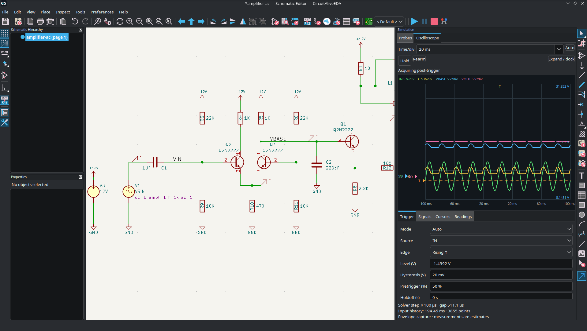
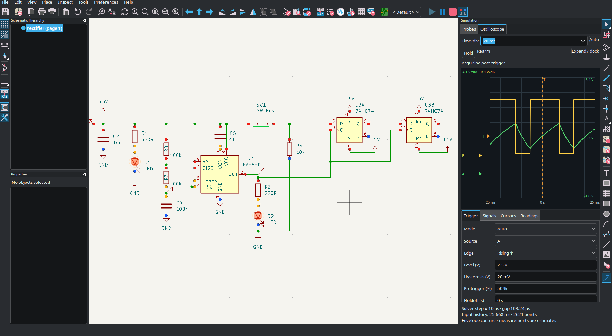
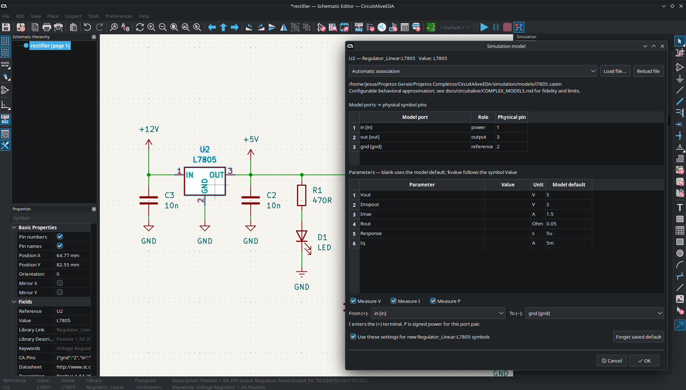
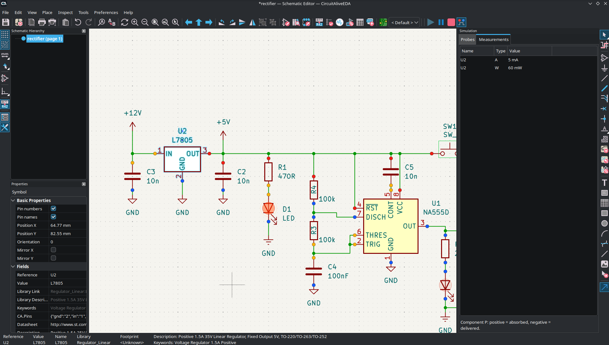

<div align="center">

# CircuitAliveEDA


**Desenhar, simular e desenvolver circuitos eletrônicos no mesmo lugar.**

*Projeto pessoal baseado no [KiCad](https://www.kicad.org/).*

<a href="https://github.com/ViniciusJesus-art/CircuitAliveEDA/releases/latest/download/CircuitAliveEDA-windows-x86_64-setup.exe">
  
</a>
&nbsp;&nbsp;
<a href="https://github.com/ViniciusJesus-art/CircuitAliveEDA/releases/latest/download/CircuitAliveEDA-linux-x86_64.AppImage">
  
</a>
&nbsp;&nbsp;
<a href="https://github.com/ViniciusJesus-art/CircuitAliveEDA/releases">
  
</a>

**Read the English version 🇬🇧 [here](/README.md)**

---

## O que é o CircuitAliveEDA?

O CircuitAliveEDA é um **ambiente de desenvolvimento eletrônico baseado no KiCad**, com modificações próprias focadas principalmente na simulação interativa.

A intenção é que a simulação não seja uma etapa separada do desenho. Você monta o circuito usando símbolos eletrônicos, inicia a execução e acompanha o comportamento dos componentes diretamente no esquemático. Também pode interagir com determinados elementos, fazer medições e analisar sinais enquanto trabalha.

Por utilizar o KiCad como base, o projeto também mantém o caminho para o desenvolvimento de placas de circuito impresso, incluindo bibliotecas, edição de PCB e geração dos arquivos necessários para fabricação. Quero preservar o máximo possível dessa compatibilidade, tanto com o KiCad quanto com as bibliotecas e ferramentas criadas por sua comunidade.

**O CA ainda está em desenvolvimento.** Algumas funcionalidades já estão implementadas, outras têm suporte inicial e várias fazem parte dos objetivos futuros. Não é uma versão oficial do KiCad nem tem qualquer afiliação com sua equipe.

---

#### **O CircuitAliveEDA é um projeto estritamente pessoal, desenvolvido e moldado de acordo com o que eu gostaria de encontrar em um software de desenvolvimento eletrônico: uma ferramenta intuitiva, prática e, ao mesmo tempo, profissional, que me permita desenvolver meus projetos desde os primeiros testes até a criação da PCB.**

#### **O projeto continuará evoluindo conforme minhas necessidades e ideias. Contudo, se mais alguém se identificar com essa proposta ou encontrar utilidade no programa, fique à vontade para utilizá-lo também!**

</div>

## Sumário

- [O que é o CircuitAliveEDA?](#o-que-é-o-circuitaliveeda)
- [Mudanças](#mudanças)
- [Imagens do projeto](#imagens-do-projeto)
- [O que ainda quero desenvolver](#o-que-ainda-quero-desenvolver)
- [Como funciona por dentro](#como-funciona-por-dentro)
- [Especificações rápidas](#especificações-rápidas)
- [Documentação](#documentação)
- [Compilação e execução](#compilação-e-execução)
- [Créditos e agradecimentos](#créditos-e-agradecimentos)
- [Licenciamento](#licenciamento)

---

## Mudanças

Estas são as adições e mudanças de fluxo desenvolvidas no CircuitAliveEDA sobre sua base KiCad. O editor de esquemáticos, o editor de PCB, o sistema de bibliotecas e as ferramentas de fabricação continuam vindo do KiCad. As seções abaixo explicam o que o CA acrescenta para quem está abrindo o programa pela primeira vez.

### Simulação interativa no esquemático

Monte o circuito, aperte **Play** e acompanhe seu comportamento no mesmo editor em que você desenha. O CA integra **ngspice** e **XSPICE** com controles para iniciar, pausar, continuar e interromper a simulação, ajustar sua velocidade ou avançar um passo enquanto estiver pausada.

- Clique nas chaves compatíveis para mudar seu estado durante a simulação.
- Ajuste potenciômetros e trimpots compatíveis sem reiniciar a sessão nem perder o estado armazenado no circuito.
- Acompanhe o brilho dos LEDs e os indicadores lógicos de `0`, `1`, `Z` (alta impedância) e `X` (indefinido).
- Coloque sondas de tensão e osciloscópio nos fios ou diretamente nas pontas dos pinos dos componentes; sondas de corrente e potência usam um trecho de fio para seu sensor em série. Você também pode habilitar medições no próprio componente.
- Acione entradas digitais com uma **probe 0/1** clicável (azul/vermelha), ou coloque **geradores de PWM, onda quadrada e senoide** configuráveis, referenciados ao GND. O duty cycle do PWM pode ser ajustado durante a simulação.
- Examine as formas de onda com cursores e disparo do osciloscópio e exporte as amostras em CSV.

Veja [medições e osciloscópio](docs/circuitalive/MEASUREMENTS.md) e [ajustes durante a simulação](docs/circuitalive/LIVE_CONTROLS.md).

### Modelos de componentes e vínculos padrão dos símbolos

O CA fornece os comportamentos de simulação em **arquivos `.casim`**, associados aos símbolos da biblioteca padrão. O catálogo foi ampliado com:

- Resistores, capacitores, indutores, redes resistivas, divisores de tensão, potenciômetros, chaves e relés de bobina DC.
- Diodos, Zeners, LEDs, pontes retificadoras, conjuntos de diodos, transistores bipolares, MOSFETs, JFETs e drivers Darlington.
- Amplificadores operacionais, comparadores, reguladores, optoacopladores, chaves e multiplexadores analógicos, portas lógicas, disparadores Schmitt, flip-flops, registradores, decodificadores e contadores.

Os vínculos são conferidos pela numeração dos pinos físicos e pela função do componente. Desenhos compatíveis de resistores, capacitores, diodos e chaves já recebem seu modelo pelos arquivos distribuídos com o CA. Chaves de vários contatos, bancos DIP, pacotes resistivos e shunts Kelvin usam ligações adequadas aos seus terminais, em vez de serem tratados como peças simples de dois terminais.

Esses padrões acompanham a instalação; não dependem das preferências do desenvolvedor nem de configurar cada símbolo manualmente. Um modelo escolhido explicitamente para o componente ou salvo em um perfil pessoal conserva a prioridade. **A cobertura ainda é parcial:** a meta é cobrir os componentes eletrônicos padrão, mas ter um símbolo na biblioteca não significa que ele já tenha modelo de simulação. Conectores, itens mecânicos e gráficos ficam fora dessa meta de cobertura de modelos.

Veja o [catálogo de modelos](docs/circuitalive/MODEL_CATALOG.md) e os [vínculos revisados da biblioteca padrão](docs/circuitalive/STANDARD_LIBRARY_ASSOCIATIONS.md).

### Comportamento elétrico e limites dos modelos

Os modelos vão além de mostrar estados lógicos ideais. Conforme o componente, incluem faixas de tensão de alimentação, limiares de entrada, atrasos de propagação, resistência e quedas de tensão nas saídas, capacitância de entrada, consumo em repouso, fuga e limites ou avisos de corrente. A carga e o fan-out afetam a resposta elétrica pelas entradas e saídas modeladas. Os tempos de comutação e a frequência de operação dependem dos parâmetros e comportamentos implementados em cada modelo.

São aproximações nominais, com níveis de detalhe diferentes entre os modelos. Não garantem todos os limites de um datasheet, e temperatura, autoaquecimento e dano permanente ficam fora do escopo atual. A documentação registra os comportamentos atendidos e as limitações restantes.

Os diodos incluem condução direta, fuga reversa e ruptura quando configurada. Um terminal conectado apenas a uma sonda ideal de tensão pode flutuar próximo da tensão da fonte mesmo com o bloqueio da corrente de carga; o [guia de polarização reversa](docs/circuitalive/DIODE_REVERSE_BIAS.md) explica como testar isso com uma carga e retorno ao GND.

### Editor visual de modelos e configurações reutilizáveis

O **Simulation Model Editor**, em uma janela própria, permite escolher um símbolo da biblioteca, importar seus pinos, montar o comportamento com blocos, conectar terminais, expor parâmetros e salvar um arquivo `.casim` reutilizável. Modelos existentes também podem servir de ponto de partida.

No esquemático, **Simulation model...** (**Ctrl+Alt+M**) configura o modelo, o mapa de pinos, os parâmetros e as medições. O navegador de modelos oferece categorias, famílias e busca. As configurações podem ser salvas como padrão para novas instâncias do mesmo símbolo de biblioteca, enquanto as instâncias existentes conservam sua configuração. Modelos expressáveis pelos blocos disponíveis ou por SPICE podem ser acrescentados sem recompilar o aplicativo.

Veja o [editor visual de modelos](docs/circuitalive/MODEL_AUTHOR.md) e as [configurações reutilizáveis](docs/circuitalive/COMPLEX_MODELS.md).

### Imagens de memória e execução de firmware

Os modelos de ROM e RAM compatíveis podem carregar arquivos de dados iniciais. Um visualizador de memória captura o estado da simulação pausada, mostra endereços, bytes e bits indefinidos e exporta os dados em BIN, Intel HEX ou snapshots `.camem` do CA.

Nos modelos fornecidos de ATmega48P/88P/168P/328P, Arduino UNO R3 e PIC16F84A, o CA pode executar firmware HEX/BIN pelos runtimes incluídos. Cada instância tem seu próprio firmware, clock, memória e conexões elétricas dos pinos. O firmware é compilado com as ferramentas externas habituais do dispositivo. Outros microcontroladores, dispositivos STM/ESP e FPGAs ainda precisam de seus próprios motores e modelos implementados.

Veja [imagens de memória](docs/circuitalive/MEMORY_IMAGES.md) e [modelos programáveis](docs/circuitalive/MICROCONTROLLER_MODELS.md).

### Inserção e reaproveitamento de itens no esquemático

O fluxo de inserção foi padronizado para componentes, símbolos de alimentação, rótulos, texto, imagens, formas, tabelas e folhas:

1. Use o atalho ou comando da barra, escolha o item e confirme.
2. O item acompanha o cursor; clique para colocá-lo, e a prévia desaparece.
3. Clique em espaço vazio para trazer o mesmo item de volta ao cursor.
4. Clique novamente para colocar outra cópia, sem reabrir o seletor.

Acionar o atalho ou comando novamente abre uma nova escolha. Os itens ligados diretamente aos fios mantêm a inserção direta. Componentes com várias unidades podem continuar pelas unidades disponíveis, mantendo referências como U1A/U1B juntas.

O painel **Used Components** lista os tipos de componentes já presentes na página atual, com uma prévia do símbolo. Selecione um tipo e use o mesmo par de cliques para inserir outra instância com uma referência nova. Para componentes com várias unidades, ele coloca todas elas, incluindo as de alimentação, antes de iniciar o próximo encapsulamento (por exemplo, U2:A → U2:B → U2:C → U3:A). O painel pode ser encaixado, deixado flutuante e redimensionado; suas preferências de disposição são mantidas entre projetos.

Veja o [fluxo de inserção](docs/circuitalive/PLACEMENT_WORKFLOW.md) e o [painel de componentes usados](docs/circuitalive/USED_COMPONENTS.md).

### Aplicação de propriedades por clique, com numeração automática

A ferramenta **Apply Properties by Click...** está na barra superior e no menu **Tools**, com o atalho padrão **Ctrl+Shift+P**. Escolha uma propriedade editável e o valor de substituição, confirme e clique nos objetos para atualizá-los. Ela atende referências, valores, footprints, nomes/textos, campos personalizados e outras propriedades aplicáveis do editor.

Ative a numeração automática para substituir `#` ou `?` em um padrão. Por exemplo, `Digital_D#`, começando em `10` com passo `2`, aplica `Digital_D10`, `Digital_D12`, `Digital_D14` e assim por diante. Um passo negativo faz a contagem decrescer. Cliques vazios ou recusados não consomem um número, e o cursor mostra o próximo valor.

Com a criação de rótulos em fios habilitada, clicar em um fio ou na ponta de um pino de componente cria um rótulo local, global ou hierárquico conectado, usando o nome gerado. Desative essa opção para editar propriedades do próprio fio. As edições comuns têm desfazer/refazer, os campos dos componentes respeitam a variante ativa e as unidades relacionadas são mantidas em sincronia. **Esc** encerra a ferramenta.

Veja [aplicação de propriedades por clique](docs/circuitalive/PROPERTY_STAMP.md).

### Páginas, navegação e gestos do mouse

O menu **Pages** permite criar, renomear, reordenar, remover e navegar pelas páginas do esquemático, incluindo várias páginas principais em um projeto. A ordem das páginas é preservada ao salvar e reabrir. Os indicadores e controles de simulação pertencem ao caminho completo da folha, de modo que a navegação mantém os controles de cada página associados ao circuito correto.

Um **duplo clique direito** exclui o item sob o ponteiro pela ação normal de exclusão do editor, com suporte a desfazer. Um clique direito simples continua abrindo o menu de contexto. Nos campos de símbolos, o comportamento normal de exclusão oculta o campo.

Veja [páginas do esquemático](docs/circuitalive/PAGES.md).

### Vínculos entre esquemático e PCB

Todas as páginas do projeto alimentam a mesma PCB do projeto. **Update PCB from Schematic** preserva a identidade do símbolo quando as referências mudam (por exemplo, U1 para U12), as unidades ficam distribuídas entre páginas ou um símbolo muda de página. A opção existente de revincular por referência continua disponível para recuperar associações antigas. As posições dos footprints e o roteamento existentes são preservados; mudar o footprint atribuído usa o processo normal de substituição de footprints.

Quando um símbolo é excluído, a próxima atualização da PCB mantém seu footprint com um aviso **Missing schematic symbol** na camada de comentários e limpa as atribuições de rede dos pads. A janela de atualização permite remover os footprints sem símbolos. Footprints exclusivos da PCB são preservados. Referências duplicadas ou candidatos ambíguos de recuperação são informados antes de aplicar mudanças. Veja [vínculos entre esquemático e PCB](docs/circuitalive/PCB_LINKS.md).

### Bibliotecas incluídas na instalação

Os pacotes do CA incluem símbolos, footprints, modelos 3D, templates de projetos, modelos de simulação, blocos e runtimes. O aplicativo inicializa as tabelas de bibliotecas no primeiro uso sem exigir uma instalação separada do KiCad nem downloads de bibliotecas, preservando as bibliotecas pessoais.

Veja [bibliotecas incluídas](docs/circuitalive/BUNDLED_LIBRARIES.md).

## Imagens do projeto

As imagens abaixo mostram o CircuitAliveEDA durante o desenvolvimento:









---

## O que ainda quero desenvolver

Não quero que o CA fique limitado a circuitos pequenos ou exemplos didáticos. Minha intenção é que ele também sirva para projetos maiores, com centenas ou milhares de elementos, circuitos analógicos e digitais, memórias, processadores e outros sistemas eletrônicos.

Algumas das ideias que quero explorar:

- Ampliar a biblioteca de componentes que podem ser simulados sem configurações complicadas.
- Permitir a criação e reutilização de modelos personalizados de maneira modular.
- Melhorar os instrumentos virtuais e a interação com os circuitos durante a execução.
- Investigar formas de aproveitar melhor os vários núcleos do processador em simulações complexas.
- Manter um fluxo contínuo entre a ideia, os testes no esquemático e a fabricação da PCB.

Esses são **objetivos de desenvolvimento**, não uma lista de funcionalidades já concluídas. Prefiro registrar o caminho que quero seguir e ir documentando os resultados conforme forem aparecendo.

---

## Como funciona por dentro

O CircuitAliveEDA é um projeto derivado do **KiCad 10.0.7**, desenvolvido principalmente em **C++**. A interface e as ferramentas de esquemático e PCB partem da infraestrutura do KiCad, enquanto as funcionalidades de simulação interativa são integradas por módulos próprios.

### Motor de simulação

O projeto utiliza o **ngspice** como motor de simulação de circuitos e o **XSPICE** para funcionalidades de simulação digital. Sobre essa base, foi desenvolvida uma camada de controle para gerenciar sessões interativas e conectar a simulação às ferramentas do editor.

Isso permite trabalhar com controles de execução, acompanhamento de sinais e interação com os componentes, sem depender exclusivamente de gráficos separados do esquemático.

### Modelos e bibliotecas

A proposta é manter os símbolos e bibliotecas do ecossistema KiCad e associá-los aos modelos necessários para simulação. A estrutura de modelos do CA, incluindo arquivos `.casim`, está documentada no repositório.

O objetivo de longo prazo é que novos modelos possam ser adicionados sem exigir alterações extensas no núcleo do programa.

### Especificações rápidas

| Item | Especificação |
|---|---|
| Projeto base | KiCad 10.0.7 |
| Linguagem principal | C++ |
| Motores de simulação | ngspice / XSPICE |
| Edição de esquemático e PCB | Infraestrutura do KiCad, com modificações do CA |
| Modelos de simulação | Associação aos símbolos e arquivos `.casim` |
| Ambiente inicial de desenvolvimento | Fedora Linux |
| Compilação Windows | Documentação para MSVC |
| Situação | Projeto em desenvolvimento |
| Licenciamento | Conforme as licenças do código derivado e das dependências, incluindo GPL |

## Documentação

Para quem quiser entender melhor o funcionamento ou estudar a implementação, mantenho documentos mais técnicos em [`docs/circuitalive/`](docs/circuitalive/).

- [Compilação no Fedora](docs/circuitalive/BUILD_FEDORA.md)
- [Release manual: RPM, AppImage, DEB e EXE — juntos ou individualmente](docs/circuitalive/RELEASE_WORKFLOW.md)
- [Compilação no Windows / MSVC](docs/circuitalive/BUILD_WINDOWS.md)
- [Arquitetura da simulação interativa](docs/circuitalive/INTERACTIVE_SESSION.md)
- [Integração com o editor](docs/circuitalive/EDITOR_SIMULATION.md)
- [Medições e osciloscópio](docs/circuitalive/MEASUREMENTS.md)
- [Modelos analógicos e digitais](docs/circuitalive/BASIC_AND_DIGITAL_MODELS.md)
- [Editor visual de modelos](docs/circuitalive/MODEL_AUTHOR.md)
- [Associação de modelos](docs/circuitalive/MODEL_FILES.md)
- [Catálogo de modelos](docs/circuitalive/MODEL_CATALOG.md)
- [Vínculos de modelos com a biblioteca padrão](docs/circuitalive/STANDARD_LIBRARY_ASSOCIATIONS.md)
- [Comportamento elétrico e modelos Schmitt](docs/circuitalive/SCHMITT_ELECTRICAL_MODELS.md)
- [Verificação de polarização reversa dos diodos](docs/circuitalive/DIODE_REVERSE_BIAS.md)
- [Imagens e inspeção de memória](docs/circuitalive/MEMORY_IMAGES.md)
- [Modelos programáveis e firmware](docs/circuitalive/MICROCONTROLLER_MODELS.md)
- [Fluxo de inserção no esquemático](docs/circuitalive/PLACEMENT_WORKFLOW.md)
- [Painel de componentes usados](docs/circuitalive/USED_COMPONENTS.md)
- [Aplicação de propriedades por clique](docs/circuitalive/PROPERTY_STAMP.md)
- [Páginas do esquemático](docs/circuitalive/PAGES.md)
- [Bibliotecas incluídas](docs/circuitalive/BUNDLED_LIBRARIES.md)
- [Mapa geral do desenvolvimento](docs/circuitalive/Mapa_KiCad_Simulacao_Interativa.md)

## Compilação e execução

O desenvolvimento começou no Fedora, e os scripts de compilação para esse ambiente estão no repositório. Com as dependências instaladas, o processo básico é:

```bash
tools/circuitalive/configure.sh
tools/circuitalive/build.sh
tools/circuitalive/install.sh
```

Para iniciar a aplicação, conforme a instalação:

```bash
./circuitalive
```

Consulte os guias de [Fedora](docs/circuitalive/BUILD_FEDORA.md) e [Windows/MSVC](docs/circuitalive/BUILD_WINDOWS.md) para os requisitos e instruções completas. Como o projeto ainda está em desenvolvimento, builds e recursos podem apresentar limitações ou falhas.

---

## Créditos e agradecimentos

### KiCad

O CircuitAliveEDA só é possível porque existe o **[KiCad](https://www.kicad.org/)** e porque sua equipe e comunidade construíram e mantêm uma ferramenta tão completa de desenvolvimento eletrônico.

O editor de esquemáticos, o editor de PCB, a estrutura de bibliotecas, os recursos de fabricação e grande parte da infraestrutura do CA vêm do KiCad. **Todo o crédito por esse trabalho original pertence aos desenvolvedores e colaboradores do projeto.**

- [Código-fonte do KiCad](https://gitlab.com/kicad/code/kicad)
- [Documentação de desenvolvimento](https://dev-docs.kicad.org/)

### ngspice e XSPICE

Também agradeço aos desenvolvedores do **[ngspice](https://ngspice.sourceforge.io/)** e do **XSPICE**, que fornecem uma parte essencial da tecnologia de simulação utilizada pelo CircuitAliveEDA.

### CircuitAliveEDA

As adaptações de interface, a integração da simulação interativa e as demais extensões próprias são desenvolvidas como parte deste projeto.

**Desenvolvimento: Vinicius Dias de Jesus — DMEE Technology**

## Licenciamento

Por ser derivado do KiCad, o CircuitAliveEDA deve respeitar as licenças do código original e de suas dependências, incluindo as obrigações aplicáveis da **GNU General Public License (GPL)**. Os avisos de copyright e créditos dos autores originais devem ser preservados.

O CircuitAliveEDA **não é afiliado oficialmente ao projeto KiCad**.

---

<div align="center">

**CircuitAliveEDA — DMEE Technology**

*Um projeto que comecei para os meus próprios circuitos e que quero continuar desenvolvendo e compartilhando.*

</div>
