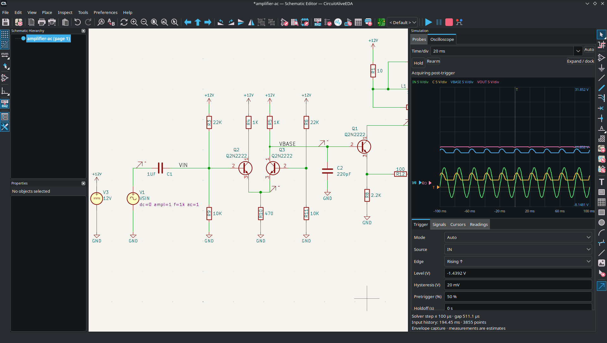
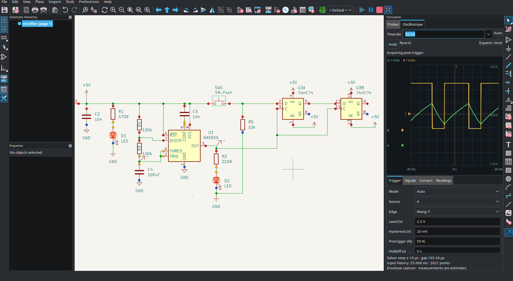
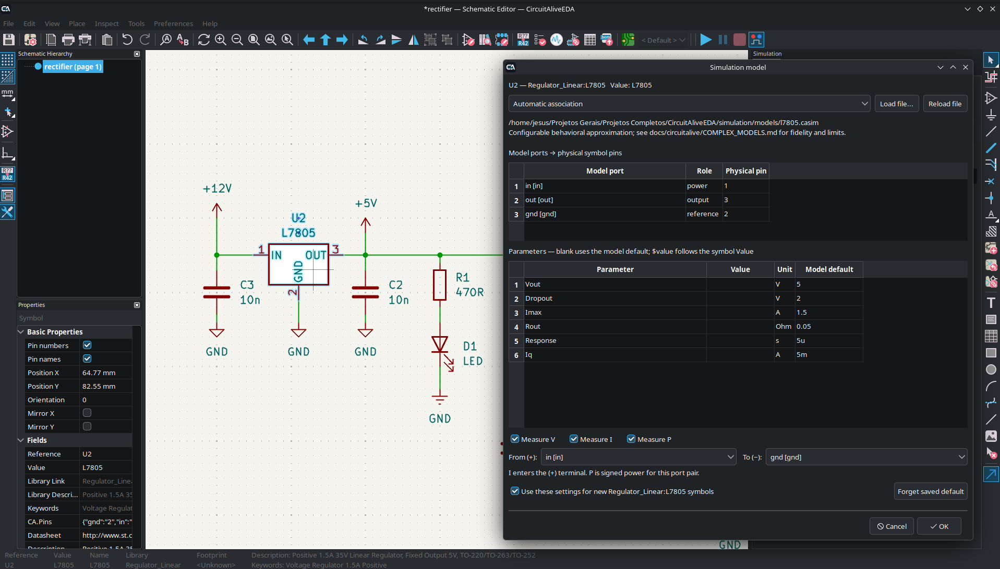
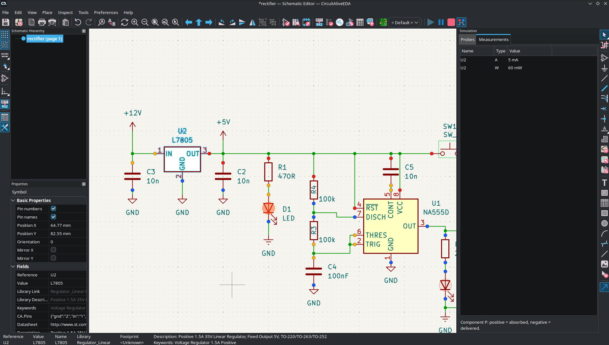

<div align="center">

# CircuitAliveEDA


**Ambiente de desenvolvimento eletrônico com simulação interativa integrada**

*Baseado no projeto open-source KiCad*


---

## Sobre o projeto

O **CircuitAliveEDA** nasceu da ideia de criar um ambiente de desenvolvimento eletrônico que reúna a facilidade de simulação encontrada em programas como o Proteus com as ferramentas profissionais de desenvolvimento de circuitos e placas de circuito impresso oferecidas pelo KiCad. De uma forma gratuita e pessoal. 

A motivação surgiu durante o desenvolvimento de meus próprios projetos eletrônicos, quando percebi que muitos programas de simulação exigiam diversas configurações antes mesmo de realizar testes relativamente simples.

Minha intenção é tornar esse processo mais natural: desenhar um circuito, iniciar a simulação e observar seu comportamento diretamente no esquemático, sem precisar alternar constantemente entre ferramentas, configurar manualmente diversos parâmetros ou interpretar exclusivamente gráficos externos. E posteriormente o desenho profissional da PCB. 

Para isso, decidi utilizar o **KiCad como base**, aproveitando sua infraestrutura de edição de esquemáticos, gerenciamento de bibliotecas, desenvolvimento de PCBs e geração de arquivos para fabricação.

O CircuitAliveEDA não pretende simplesmente substituir o KiCad, mas expandir suas capacidades, principalmente na área de simulação eletrônica.

A proposta é que um mesmo ambiente possa acompanhar todo o desenvolvimento de um projeto, desde os primeiros testes de funcionamento até o desenho final da PCB e sua fabricação.

**Este é um projeto pessoal, desenvolvido principalmente para os meus projetos em eletrônica. Porem esta aberto para qualquer um que esta procurando um programa como esse.**

---

</div>

## Objetivos

O principal objetivo do CircuitAliveEDA é proporcionar uma experiência de simulação mais intuitiva, mantendo a precisão e os recursos necessários para trabalhos eletrônicos reais.

Entre os principais objetivos estão:

- **Simulação diretamente no esquemático:** observar o comportamento dos componentes enquanto o circuito está sendo simulado.
- **Controles interativos:** iniciar, pausar, continuar e interromper a simulação a qualquer momento.
- **Componentes interativos:** permitir a atuação de chaves, botões e outros elementos durante a execução.
- **Instrumentos virtuais:** disponibilizar ferramentas como osciloscópios e medições de tensão, corrente e potência.
- **Bibliotecas de modelos:** facilitar a associação entre símbolos eletrônicos e seus respectivos modelos de simulação.
- **Simulação analógica e digital:** trabalhar com circuitos que combinam componentes discretos, circuitos integrados e lógica digital.
- **Desempenho:** investigar métodos de melhorar o aproveitamento de processadores modernos, principalmente em simulações complexas.
- **Integração com PCB:** preservar o fluxo de desenvolvimento do KiCad, permitindo transformar circuitos testados em placas prontas para fabricação.

A ideia é que a simulação deixe de parecer uma ferramenta separada e passe a fazer parte do próprio processo de desenhar e desenvolver circuitos eletrônicos.

---

## O que já foi desenvolvido

O CircuitAliveEDA ainda está em desenvolvimento, mas já possui uma implementação inicial de simulação interativa integrada ao editor de esquemáticos.

### Simulação interativa

O sistema utiliza o **ngspice** como motor de simulação, com uma camada própria de controle responsável por gerenciar as sessões interativas.

Atualmente, já foram implementados:

- Controles de Play, Pause e Stop.
- Integração da simulação com o editor de esquemáticos.
- Interação com chaves durante a execução.
- Representação visual do funcionamento de LEDs.
- Medições de tensão, corrente e potência.
- Ferramentas de osciloscópio com cursores, trigger e exportação CSV.
- Suporte inicial a circuitos digitais utilizando XSPICE.
- Indicação dos estados lógicos `0`, `1`, `Z` e `X`.
- Testes com circuitos analógicos e digitais.

### Modelos de componentes

Uma das áreas trabalhadas é a criação de uma estrutura que permita configurar e reutilizar modelos eletrônicos sem depender de procedimentos complexos para cada componente.

O projeto já conta com suporte e documentação para diversos componentes discretos, modelos digitais e associação de modelos aos símbolos.

O [catálogo de modelos](docs/circuitalive/MODEL_CATALOG.md) descreve os arquivos `.casim`, os componentes adicionados, os testes e a ferramenta para acompanhar a cobertura da biblioteca padrão.

Também foi iniciado um editor visual de modelos, permitindo configurar componentes por meio de uma interface própria.

A intenção futura é ampliar esse sistema para que componentes mais complexos possam ser modelados e utilizados com facilidade, inclusive por meio de modelos personalizados.

### Editor de esquemáticos

Algumas modificações também foram feitas na interação com o editor.

Entre elas estão ajustes na colocação contínua de símbolos e a possibilidade de excluir elementos utilizando um duplo clique com o botão direito do mouse.

São mudanças relativamente pequenas, mas fazem parte da ideia de deixar o ambiente mais rápido e intuitivo durante o desenvolvimento.

---




---



---



---




## Visão de futuro

Um dos maiores desafios do projeto será desenvolver uma arquitetura de simulação capaz de lidar com circuitos progressivamente maiores.

Não quero que o CircuitAliveEDA fique limitado a exemplos simples com poucos componentes.

A intenção é que, no futuro, seja possível simular circuitos contendo centenas ou milhares de elementos, incluindo componentes analógicos, circuitos digitais, memórias, processadores e outros sistemas eletrônicos.

Também pretendo estudar formas de distribuir melhor o trabalho de simulação entre os núcleos disponíveis no processador, sem comprometer a consistência e os resultados da simulação.

Outro objetivo importante é permitir que novos modelos de componentes sejam desenvolvidos e integrados ao simulador de maneira modular, evitando modificações extensas no núcleo do programa sempre que um componente for adicionado.

Esses são objetivos de longo prazo, e não funcionalidades necessariamente disponíveis na versão atual.

---

## Por que utilizar o KiCad?

O [KiCad](https://www.kicad.org/) é um dos principais projetos de código aberto voltados ao desenvolvimento eletrônico.

Ele oferece uma base sólida para a criação de esquemáticos, desenvolvimento de placas de circuito impresso, gerenciamento de bibliotecas, visualização 3D e geração de arquivos de fabricação.

Desenvolver todas essas ferramentas do zero exigiria uma quantidade enorme de trabalho e acabaria desviando o foco do principal objetivo do CircuitAliveEDA: **a experiência de simulação eletrônica**.

Por esse motivo, escolhi trabalhar a partir do código-fonte do KiCad, preservando seus recursos e desenvolvendo novas funcionalidades sobre sua estrutura.

O CircuitAliveEDA é um projeto derivado e independente, não sendo uma versão oficial do KiCad nem possuindo vínculo oficial com sua equipe de desenvolvimento.

---

## Base técnica

| Item | Descrição |
|---|---|
| Projeto base | KiCad |
| Versão base | KiCad 10.0.7 |
| Linguagem principal | C++ |
| Motor de simulação | ngspice / XSPICE |
| Interface gráfica | Estrutura gráfica do KiCad |
| Ambiente inicial de desenvolvimento | Linux / Fedora |
| Licenciamento | Licenças aplicáveis ao KiCad e às dependências, incluindo GPL |

O desenvolvimento procura manter as modificações de simulação organizadas em módulos, facilitando a manutenção e futuras atualizações da base do KiCad.

---

## Documentação

A documentação técnica do CircuitAliveEDA está disponível no diretório `docs/circuitalive/`.

Alguns dos principais documentos são:

- [Compilação e execução](docs/circuitalive/BUILD_FEDORA.md)
- [Arquitetura da simulação interativa](docs/circuitalive/INTERACTIVE_SESSION.md)
- [Integração com o editor](docs/circuitalive/EDITOR_SIMULATION.md)
- [Medições e osciloscópio](docs/circuitalive/MEASUREMENTS.md)
- [Modelos analógicos e digitais](docs/circuitalive/BASIC_AND_DIGITAL_MODELS.md)
- [Editor visual de modelos](docs/circuitalive/MODEL_AUTHOR.md)
- [Associação de modelos de simulação](docs/circuitalive/MODEL_FILES.md)
- [Mapa geral do desenvolvimento](docs/circuitalive/Mapa_KiCad_Simulacao_Interativa.md)

A documentação continuará sendo ampliada conforme novas funcionalidades forem implementadas.

---

## Compilação e execução

O ambiente de compilação inicial foi preparado para Linux, utilizando Fedora.

Com as dependências e o ambiente devidamente configurados, os scripts do projeto podem ser utilizados para compilar e instalar o CircuitAliveEDA.

```bash
tools/circuitalive/configure.sh
tools/circuitalive/build.sh
tools/circuitalive/install.sh
```

Para iniciar:

```bash
./circuitalive
```

As instruções completas estão disponíveis no [guia de compilação](docs/circuitalive/BUILD_FEDORA.md).

O projeto permanece em desenvolvimento e pode apresentar funcionalidades incompletas ou comportamentos inesperados.

---

## Créditos e agradecimentos

### KiCad

O CircuitAliveEDA utiliza como base o código-fonte do **KiCad**, desenvolvido e mantido por sua equipe e por diversos colaboradores da comunidade open-source.

Todo o reconhecimento pelo desenvolvimento original do editor de esquemáticos, editor de PCB, bibliotecas, ferramentas auxiliares e infraestrutura pertence aos respectivos autores e colaboradores.

Sem o trabalho dessas pessoas, seria muito mais difícil desenvolver um projeto com esse alcance.

- Site oficial: https://www.kicad.org/
- Código-fonte: https://gitlab.com/kicad/code/kicad
- Documentação: https://dev-docs.kicad.org/

### ngspice e XSPICE

O projeto também utiliza tecnologias existentes de simulação de circuitos, principalmente **ngspice e XSPICE**, que fornecem parte fundamental da infraestrutura de simulação analógica e digital.

O desenvolvimento desses motores e de suas respectivas funcionalidades pertence a seus autores e contribuidores.

- ngspice: https://ngspice.sourceforge.io/

### CircuitAliveEDA

As modificações específicas do CircuitAliveEDA, sua integração de simulação interativa, ferramentas adicionais e demais extensões são desenvolvidas como parte deste projeto.

**Desenvolvimento: Vinicius Dias de Jesus — DMEE Technology**

---

## Licenciamento

O CircuitAliveEDA é um projeto derivado do KiCad e, portanto, deve respeitar as condições das licenças aplicáveis ao código original e às dependências utilizadas.

As modificações realizadas sobre os componentes licenciados sob a GNU General Public License (GPL) permanecem sujeitas às respectivas obrigações de licenciamento e distribuição.

Os avisos de copyright, arquivos de licença e créditos originais devem ser preservados.

O código desenvolvido especificamente para o CircuitAliveEDA também deve respeitar essas obrigações quando constituir parte derivada do software original.

O projeto não é afiliado oficialmente à equipe do KiCad.

---

## Considerações finais

O CircuitAliveEDA começou como uma ideia relativamente simples: tornar a simulação de circuitos eletrônicos mais acessível e integrada ao processo de desenvolvimento.

Com o avanço da implementação, naturalmente surgiram novas possibilidades e desafios, especialmente relacionados à criação de modelos, arquitetura de simulação e desempenho.

Não existe a intenção de competir diretamente com grandes ferramentas comerciais, mas sim de desenvolver um ambiente que eu mesmo gostaria de utilizar em meus projetos.

**CircuitAliveEDA — DMEE Technology**

*Desenvolvido por Vinicius Dias de Jesus.*

---

**Agradecimentos especiais à equipe e à comunidade do KiCad, bem como aos desenvolvedores do ngspice e de todas as tecnologias de código aberto utilizadas neste projeto.**
