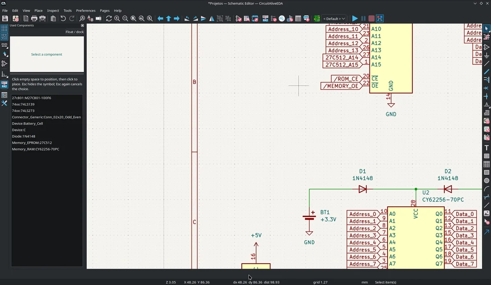
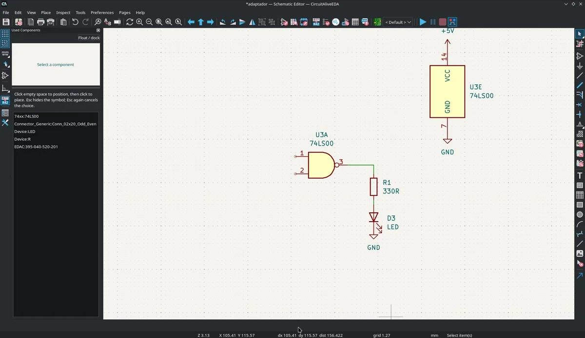
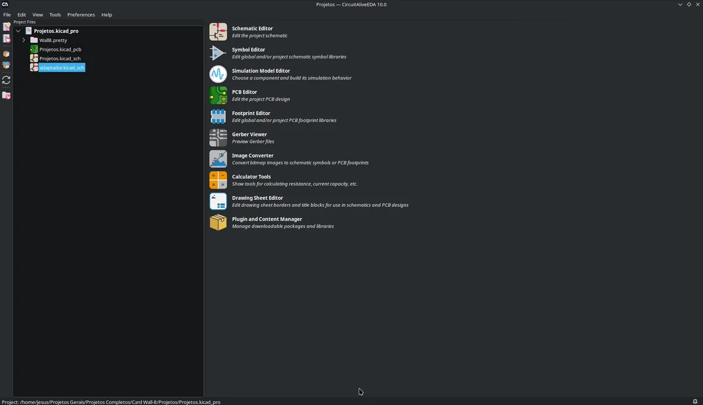
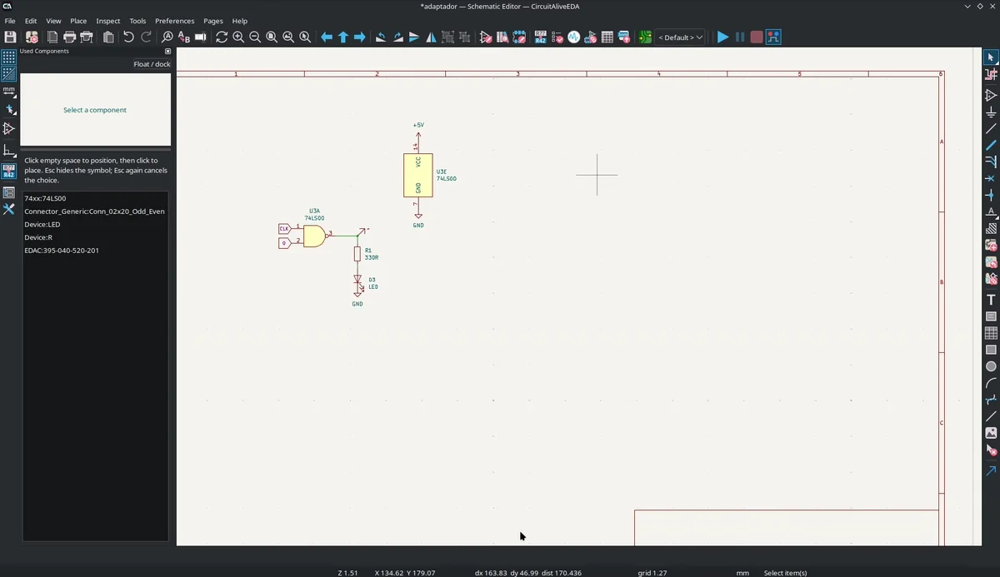
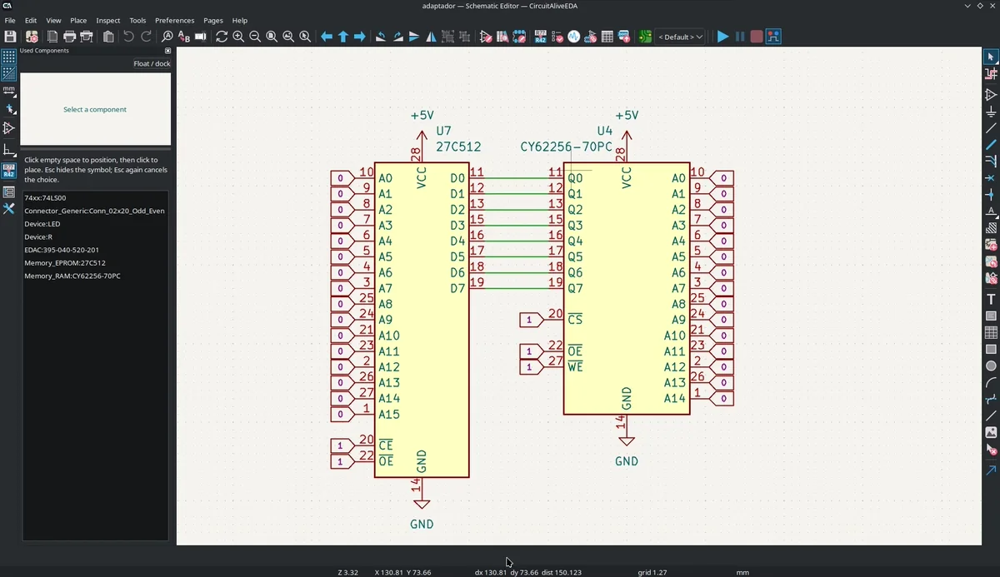
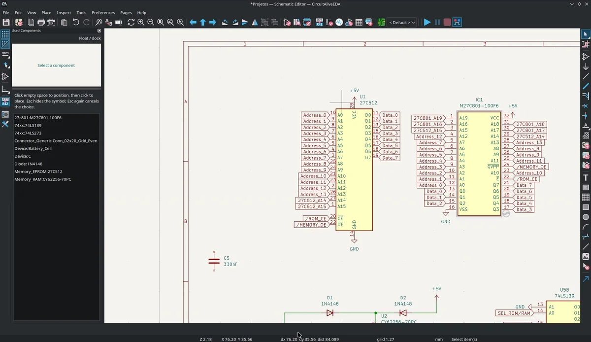
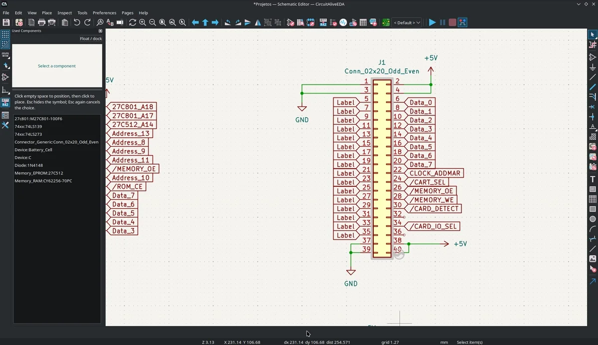
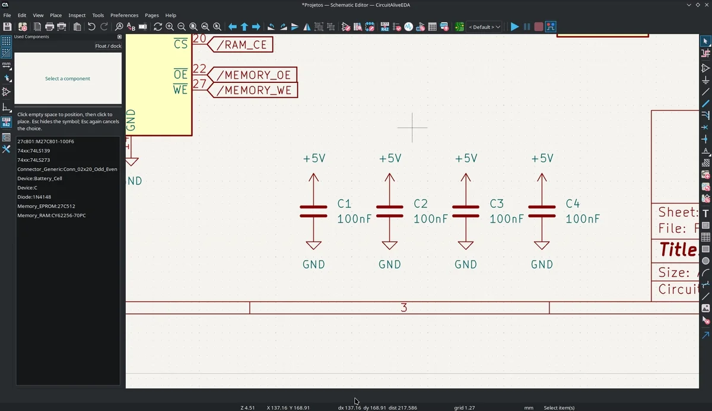
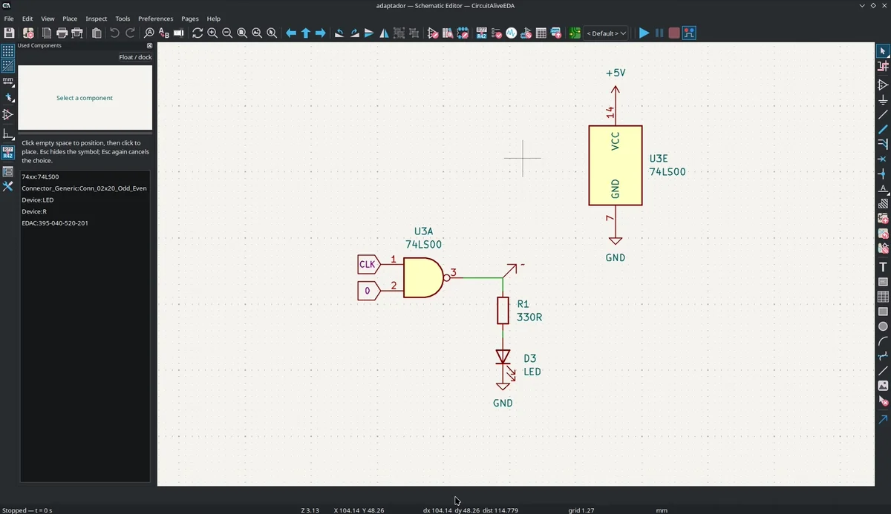
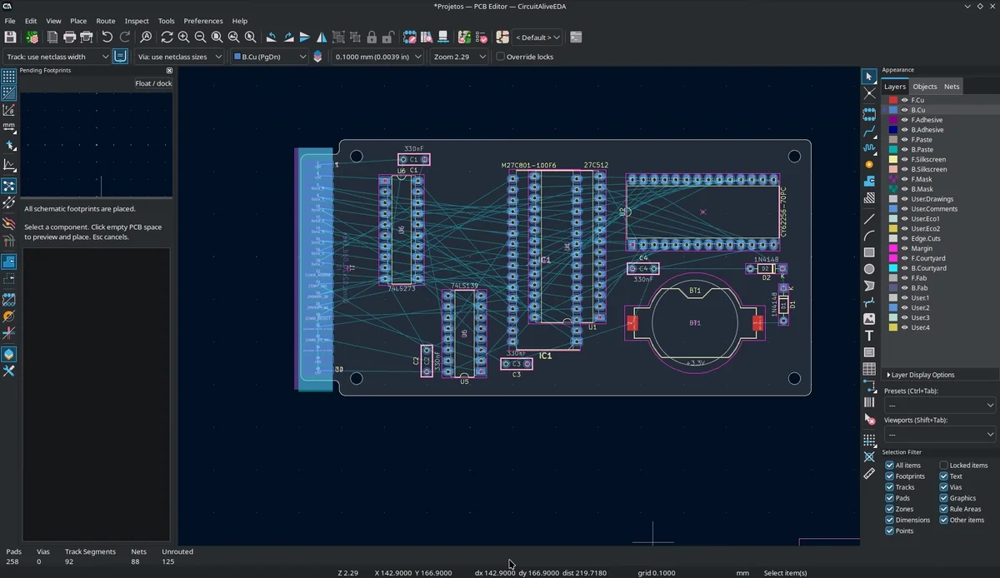

<div align="center">

# CircuitAliveEDA


**Design, simulate, and develop electronic circuits in one place.**

*An independent personal project based on [KiCad](https://www.kicad.org/).*

<a href="https://github.com/ViniciusJesus-art/CircuitAliveEDA/releases/latest/download/CircuitAliveEDA-windows-x86_64-setup.exe">
  
</a>
&nbsp;&nbsp;
<a href="https://github.com/ViniciusJesus-art/CircuitAliveEDA/releases/latest/download/CircuitAliveEDA-linux-x86_64.AppImage">
  
</a>
&nbsp;&nbsp;
<a href="https://github.com/ViniciusJesus-art/CircuitAliveEDA/releases">
  
</a>

**Veja a versão em Português 🇧🇷 [aqui](/README-PT_BR.md)**

---

## What is CircuitAliveEDA?

CircuitAliveEDA is a **KiCad-based electronics development environment**, with custom modifications focused primarily on interactive simulation.

The idea is to make simulation a natural part of circuit design rather than a separate step. You build a circuit using electronic symbols, start the simulation, and watch the components behave directly on the schematic. You can also interact with certain elements, take measurements, and analyze signals as you work.

Because the project is based on KiCad, it also retains the tools needed for printed circuit board development, including libraries, PCB editing, and generating the files required for manufacturing. I want to preserve as much compatibility as possible with KiCad itself, as well as the libraries and tools created by its community.

**CA is still under development.** Some features are already implemented, others have initial support, and many remain future goals. This is not an official version of KiCad and is not affiliated with the KiCad team.

---

#### **CircuitAliveEDA is a strictly personal project, developed and shaped around what I would like to see in electronics design software: an intuitive, practical, yet professional tool that lets me take my projects from the first experiments all the way to PCB design.**

#### **The project will continue to evolve according to my needs and ideas. That said, if anyone else shares this vision or finds the software useful, they are more than welcome to use it too!**

</div>

## Table of Contents

- [What is CircuitAliveEDA?](#what-is-circuitaliveeda)
- [Changes](#changes)
- [How it works internally](#how-it-works-internally)
- [Quick specifications](#quick-specifications)
- [Documentation](#documentation)
- [Building and running](#building-and-running)
- [Credits and acknowledgments](#credits-and-acknowledgments)
- [Licensing](#licensing)

---

## Changes

These are the additions and workflow changes developed for CircuitAliveEDA on top of its KiCad base. The schematic editor, PCB editor, library system, and manufacturing tools still come from KiCad. The sections below explain what CA adds for someone opening the program for the first time.


<h3 align="center">
  Interactive simulation on the schematic
</h3>

<p align="center">
  
</p>

Build the circuit, press **Play**, and follow its behavior in the same editor where you draw it. CA integrates **ngspice** and **XSPICE** with controls to start, pause, resume, and stop the simulation, adjust its speed, or advance by a step while paused. After a delay, playback resumes at the selected speed without a burst of accelerated cycles.

- Click supported switches to change their state during simulation.
- Adjust supported potentiometers and trimmers without restarting the session or losing the circuit's stored state.
- Watch LED brightness and logic indicators for `0`, `1`, `Z` (high impedance), and `X` (unknown).
- Disabled outputs read the shared bus level, including signals driven by RAM or pull resistors. Opposing active outputs highlight the entire wire in pink and show a warning without pausing; current and voltage remain calculated by the electrical models.
- Place probes directly on a connection, or click empty space to preview and click again to place them freely; wires can be connected afterward. The moving preview has the same blue highlight as components and rotates with **R**. Current and power probes insert a series sensor when placed on a wire. You can also enable measurements on a component.
- Drive digital inputs with a clickable **0/1 probe** (blue/red), or place configurable **PWM, square-wave, and sine-wave generators**, referenced to GND. Double-click a probe, press **E**, or choose **Probe properties...** to edit frequency, voltages, duty cycle, and other settings. PWM duty cycle can also be adjusted during simulation. A probe’s name and internal text belong to the whole probe for selection and deletion.
- Starting a simulation selects **Measurements** when voltage, current, or power readings are present; with only oscilloscope probes, it selects **Oscilloscope**, regardless of the previously selected tab.
- Stimulus probes fit beside adjacent IC pins, orient away from the component, and keep their number attached during box selection. Duplicating, pasting, or repeating probes gives every stimulus, measurement, and oscilloscope probe a fresh identifier; older duplicated probe identifiers are repaired automatically.
- Inspect waveforms with oscilloscope cursors and triggering, and export samples as CSV.

See [measurements and oscilloscope](docs/circuitalive/MEASUREMENTS.md) and [live controls](docs/circuitalive/LIVE_CONTROLS.md).

---


<h3 align="center">
  Component models and default symbol associations
</h3>

<p align="center">
  
</p>

CA supplies simulation behavior in **`.casim` files**, associated with standard library symbols. The catalog has been expanded with:

- Resistors, capacitors, inductors, resistor networks, voltage dividers, potentiometers, switches, and DC-coil relays.
- Diodes, Zeners, LEDs, rectifier bridges, diode arrays, bipolar transistors, MOSFETs, JFETs, and Darlington drivers.
- Operational amplifiers, comparators, regulators, optocouplers, analog switches and multiplexers, logic gates, Schmitt triggers, flip-flops, registers, decoders, and counters.

The associations are checked against physical pin numbers and component function. Compatible drawings of resistors, capacitors, diodes, and switches already receive their model from the files shipped with CA. Multi-contact switches, DIP banks, resistor packs, and Kelvin shunts use connections appropriate to their terminals, rather than being treated as simple two-terminal parts.

These defaults are included in the installation; they do not depend on the developer's preferences or on configuring each symbol manually. A model explicitly selected for a component or saved in a personal profile retains priority. **Coverage is still partial:** the goal is to cover the standard electronic components, but having a symbol in the library does not mean it already has a simulation model. Connectors, mechanical items, and graphics are outside that model-coverage goal.

See the [model catalog](docs/circuitalive/MODEL_CATALOG.md) and [reviewed standard library associations](docs/circuitalive/STANDARD_LIBRARY_ASSOCIATIONS.md).

---


<h3 align="center">
  Electrical behavior and model limits
</h3>

<p align="center">
  
</p>

The models go beyond displaying ideal logic states. Depending on the component, they include supply voltage ranges, input thresholds, propagation delays, output resistance and voltage drops, input capacitance, quiescent consumption, leakage, and current limits or warnings. Load and fan-out affect the electrical response through the modeled inputs and outputs. Switching times and operating frequency depend on the parameters and behavior implemented for each model.

These are nominal approximations, with different levels of detail between models. They do not guarantee every datasheet limit, and temperature, self-heating, and permanent damage are outside the current scope. The documentation records the supported behavior and remaining limitations.

On digital buses, an output in **Z** releases the connection: its indicator shows the electrical level established by whichever device is still driving it. For example, a 27C512 EPROM with its output disabled can show the data supplied by RAM on the same bus. A truly floating net appears as **Z**; a voltage outside valid logic levels can appear as **X**, according to the component's thresholds and supply.

When active outputs try to impose opposite levels with contention current, the entire wire is highlighted in pink and the pin indicators show **!**, with a warning identifying the participants. Simulation continues, and the warning clears when contention ends. Pull-up/pull-down resistors and inputs are not treated as competing outputs; resistances, currents, and voltage drops remain part of the electrical solution. See [analog and digital models](docs/circuitalive/BASIC_AND_DIGITAL_MODELS.md).

Diodes include forward conduction, reverse leakage, and breakdown where configured. A terminal connected only to an ideal voltage probe can float near the supply voltage even when load current is blocked; the [reverse-bias guide](docs/circuitalive/DIODE_REVERSE_BIAS.md) explains how to test this with a load and a return to GND.

---


<h3 align="center">
  Visual model editor and reusable settings
</h3>

<p align="center">
  
</p>

The separate **Simulation Model Editor** lets you choose a library symbol, import its pins, assemble behavior from blocks, connect terminals, expose parameters, and save a reusable `.casim` file. Existing models can also be used as a starting point.

In the schematic, **Simulation model...** (**Ctrl+Alt+M**, also available through the **Simulation Model...** button in Symbol Properties) configures the model, pin mapping, parameters, and measurements. The model browser offers categories, families, and search. Settings can be saved as defaults for new instances of the same library symbol, while existing instances retain their configuration. Models expressible with the available blocks or SPICE can be added without recompiling the application. The original KiCad SPICE model dialog remains available in the **Symbol Editor → Symbol Properties → Simulation Model...**.

See the [visual model editor](docs/circuitalive/MODEL_AUTHOR.md) and [reusable settings](docs/circuitalive/COMPLEX_MODELS.md).

---


<h3 align="center">
  Memory images and firmware execution
</h3>

<p align="center">
  
</p>

Supported ROM and RAM models can load initial data files. The field beside **Data files…** shows the filename and directory. Uninitialized SRAM bytes start at **0x00**, including locations outside a partial image; CAMEM snapshots preserve explicitly unknown bits.

Open **View memory…** from the component's context menu to inspect its memory in an independent window. The schematic and simulation controls remain accessible, and memory windows for different components can be open at the same time. Before starting, the viewer shows the initial image. While simulation runs, the table is hidden and a message asks you to pause to inspect the data; opening or closing the viewer does not pause or resume simulation.

Pausing automatically updates the table with the actual memory contents at that instant, without advancing time or modifying the circuit. Changed bytes and their ASCII text rows are highlighted in yellow, with a change count. **At the first pause, the comparison uses the initial contents loaded for that session**, including a file image when present; subsequent pauses use the previous pause's capture. Changes between known and unknown bits are also highlighted. A new pause with no changes clears the highlight, and restarting simulation establishes a new initial baseline.

The **Re-Capture** button, to the right of **Export…**, manually rereads the paused state without advancing time. It is optional because capture on pause is already automatic, and repeating a capture during the same pause preserves the baseline used to highlight changes. The table's navigation position is preserved during updates.

The viewer is read-only: it displays hexadecimal addresses, 16 bytes per row, ASCII text, and navigation to an address. `?` indicates unknown bits, rather than a zero byte or a high-impedance output. Data can be exported as BIN, Intel HEX, or CA's `.camem` snapshots, according to each format's support for unknown bits.

For the supplied ATmega48P/88P/168P/328P, Arduino UNO R3, and PIC16F84A models, CA can execute HEX/BIN firmware through the included runtimes. Each instance has its own firmware, clock, memory, and electrical pin connections. Firmware is compiled with the device's usual external tools. Other microcontrollers, STM/ESP devices, and FPGAs still require their own implemented engines and models.

See [memory images](docs/circuitalive/MEMORY_IMAGES.md) and [programmable models](docs/circuitalive/MICROCONTROLLER_MODELS.md).

---


<h3 align="center">
  Placing and reusing schematic items
</h3>

<p align="center">
  
</p>

The placement workflow has been standardized for components, power symbols, labels, text, images, shapes, tables, and sheets:

1. Use the shortcut or toolbar command, choose the item, and confirm.
2. The item follows the cursor; click to place it, and the preview disappears.
3. Click empty space to bring the same item back to the cursor.
4. Click again to place another copy, without reopening the chooser.

Invoking the shortcut or command again opens a new choice. Items attached directly to wires keep their direct placement behavior. Multi-unit components can continue through the available units, keeping references such as U1A/U1B together.

The **Used Components** panel lists the component types already on the current page, with a symbol preview. Select a type and use the same pair of clicks to place another instance with a new reference. The row stays selected between placements until the choice is canceled or another tool is activated. New symbols use the library defaults and initial chooser configuration, rather than inheriting edits to existing instances. For multi-unit parts, it places every unit, including power units, before starting the next package (for example, U2:A → U2:B → U2:C → U3:A). The panel can be docked, floated, and resized; its layout preferences are retained between projects.

See the [placement workflow](docs/circuitalive/PLACEMENT_WORKFLOW.md) and [Used Components panel](docs/circuitalive/USED_COMPONENTS.md).

---


<h3 align="center">
  Applying properties by click, with automatic numbering
</h3>

<p align="center">
  
  
</p>

The **Apply Properties by Click...** tool is available on the top toolbar and in **Tools**, with the default shortcut **Ctrl+Shift+P**. Choose an editable property and a replacement value, confirm, and click the objects to update them. It supports references, values, footprints, names/text, custom fields, and other applicable editor properties.

Enable automatic numbering to replace `#` or `?` in a pattern. For example, `Digital_D#`, starting at `10` with a step of `2`, applies `Digital_D10`, `Digital_D12`, `Digital_D14`, and so on. A negative step counts down. Empty or rejected clicks do not consume a number, and the cursor shows the next value.

With wire labeling enabled, clicking a wire or a component pin endpoint creates a connected local, global, or hierarchical label using the generated name. Labels on pins extend away from the component, including rotated or mirrored symbols. The property selector opens with one click and accepts the choice with another. Disable that option to edit properties of the wire itself. Common edits support undo/redo, component fields respect the active variant, and related units are kept in sync. **Esc** exits the tool.

See [applying properties by click](docs/circuitalive/PROPERTY_STAMP.md).

---


<h3 align="center">
  Pages, navigation, and mouse gestures
</h3>

<p align="center">
  
</p>

The **Pages** menu lets you create, rename, reorder, remove, and navigate schematic pages, including multiple top-level pages in one project. Page order is preserved when saving and reopening. The toolbar arrows follow that order from the first opening, including pages not yet visited. Saved `.kicad_sch` pages also appear in the project file tree even when their names differ from the project; opening them there uses the same project's schematic and PCB. Simulation indicators and controls belong to their full sheet path, so navigation keeps each page's controls associated with the correct circuit.

In both the schematic and PCB editors, a **double right-click** deletes the item under the pointer through the editor's normal delete action, with undo support. In the PCB editor this also covers tracks, vias, text, and graphics, respecting the normal selection filters and locks. A single right-click still opens the context menu. For symbol fields, the normal delete behavior hides the field.

See [schematic pages](docs/circuitalive/PAGES.md).

---


<h3 align="center">
  Automatic Schematic and PCB Associations with Pending Footprint List
</h3>

<p align="center">
  
</p>

All project pages feed the same project PCB. Linking by **Reference** is enabled by default: a schematic U1 uses the PCB's U1. If a reference changes (for example, U1 to U12) and the new reference has no footprint yet, the existing symbol identity recovers its placement. Units spread across pages still belong to one package. Existing footprint positions and routing are retained; changing the assigned footprint uses the normal footprint replacement process. The update dialog also offers linking by identity only.

In project mode, bringing the PCB editor into focus automatically synchronizes the components already placed: connections, references, values, fields, and assigned footprints. New schematic components are listed without being added automatically. **Update PCB from Schematic** remains available for reviewing changes and adding components in bulk.

The dockable **Pending Footprints** panel shows each unplaced component's **Reference**, **Value**, and footprint preview. Select a row, click empty PCB space to bring the footprint to the pointer, then click again to place it. The placed item leaves the list; the next empty click picks the next row automatically. Clicking an existing footprint, track, or text keeps the normal selection behavior. **Esc** cancels the preview. Placement supports undo/redo, and the list refreshes when returning to the PCB, including schematic additions, removals, and property edits. Use **View > Panels > Pending Footprints** to show or hide the panel; its docked/floating layout is saved.

When a symbol is deleted, the next PCB update keeps its footprint dimmed, with a **Missing schematic symbol** warning on the comments layer, and cleared pad net assignments. Connected sections of routed copper that no longer agree with the schematic are also dimmed, with **MISS** written along the track centerline like a net name, without needing to select them. These visual warnings survive saving and disappear when the association is restored and synchronized. Copper remains on the board for review; the indicators do not change manufacturing output. The update dialog can instead remove unused footprints. Board-only footprints are preserved. Duplicate references or ambiguous recovery candidates are reported before applying changes. See [schematic and PCB links](docs/circuitalive/PCB_LINKS.md).

<h3 align="center">
  Libraries included with the installation
</h3>

New installations start with the editor panel layout already arranged: **Used Components** on the left of the schematic, simulation instruments on the right when opened, and **Pending Footprints** on the left of the PCB with **Appearance** on the right. Personal layout changes are saved and retained.

CA packages include symbols, footprints, 3D models, project templates, simulation models, blocks, and runtimes. The application initializes the library tables on first use without requiring a separate KiCad installation or library downloads, while preserving personal libraries.

See [bundled libraries](docs/circuitalive/BUNDLED_LIBRARIES.md).

---


## How it works internally

CircuitAliveEDA is derived from **KiCad 10.0.7** and is developed primarily in **C++**. Its interface, schematic tools, and PCB tools build on KiCad's infrastructure, while the interactive simulation features are integrated through custom modules.

### Simulation engine

The project uses **ngspice** as its circuit simulation engine and **XSPICE** for digital simulation features. On top of this foundation, I have developed a control layer to manage interactive sessions and connect simulation to the editor's tools.

This makes it possible to control simulation execution, monitor signals, and interact with components without relying solely on plots displayed separately from the schematic.

### Models and libraries

The goal is to retain symbols and libraries from the KiCad ecosystem and associate them with the models needed for simulation. CA's model structure, including `.casim` files, is documented in the repository.

In the long term, I want new models to be added without requiring extensive changes to the application's core.

### Quick specifications

| Item | Specification |
|---|---|
| Base project | KiCad 10.0.7 |
| Primary language | C++ |
| Simulation engines | ngspice / XSPICE |
| Schematic and PCB editing | KiCad infrastructure with CA modifications |
| Simulation models | Symbol associations and `.casim` files |
| Initial development environment | Fedora Linux |
| Windows builds | MSVC build documentation |
| Status | Under development |
| Licensing | Subject to the licenses of the derived code and dependencies, including the GPL |

## Documentation

For anyone interested in understanding the software in greater detail or studying its implementation, I keep more technical documentation in [`docs/circuitalive/`](docs/circuitalive/).

- [Building on Fedora](docs/circuitalive/BUILD_FEDORA.md)
- [Manual releases: RPM, AppImage, DEB, and EXE — together or individually](docs/circuitalive/RELEASE_WORKFLOW.md)
- [Building on Windows / MSVC](docs/circuitalive/BUILD_WINDOWS.md)
- [Interactive simulation architecture](docs/circuitalive/INTERACTIVE_SESSION.md)
- [Editor integration](docs/circuitalive/EDITOR_SIMULATION.md)
- [Measurements and oscilloscope](docs/circuitalive/MEASUREMENTS.md)
- [Analog and digital models](docs/circuitalive/BASIC_AND_DIGITAL_MODELS.md)
- [Visual model editor](docs/circuitalive/MODEL_AUTHOR.md)
- [Model associations](docs/circuitalive/MODEL_FILES.md)
- [Model catalog](docs/circuitalive/MODEL_CATALOG.md)
- [Standard library model associations](docs/circuitalive/STANDARD_LIBRARY_ASSOCIATIONS.md)
- [Electrical behavior and Schmitt models](docs/circuitalive/SCHMITT_ELECTRICAL_MODELS.md)
- [Diode reverse-bias checks](docs/circuitalive/DIODE_REVERSE_BIAS.md)
- [Memory images and inspection](docs/circuitalive/MEMORY_IMAGES.md)
- [Programmable models and firmware](docs/circuitalive/MICROCONTROLLER_MODELS.md)
- [Schematic placement workflow](docs/circuitalive/PLACEMENT_WORKFLOW.md)
- [Used Components panel](docs/circuitalive/USED_COMPONENTS.md)
- [Apply properties by click](docs/circuitalive/PROPERTY_STAMP.md)
- [Schematic pages](docs/circuitalive/PAGES.md)
- [Bundled libraries](docs/circuitalive/BUNDLED_LIBRARIES.md)
- [Overall development map](docs/circuitalive/Mapa_KiCad_Simulacao_Interativa.md)

## Building and running

Development started on Fedora, and the repository includes build scripts for that environment. Once the dependencies are installed, the basic process is:

```bash
tools/circuitalive/configure.sh
tools/circuitalive/build.sh
tools/circuitalive/install.sh
```

To launch the application, depending on your installation:

```bash
./circuitalive
```

See the [Fedora](docs/circuitalive/BUILD_FEDORA.md) and [Windows/MSVC](docs/circuitalive/BUILD_WINDOWS.md) guides for complete requirements and instructions. As the project is still under development, builds and features may have limitations or issues.

---

## Credits and acknowledgments

### KiCad

CircuitAliveEDA would not be possible without **[KiCad](https://www.kicad.org/)** and the team and community who have built and maintained such a comprehensive electronics design tool.

The schematic editor, PCB editor, library system, manufacturing tools, and much of CA's underlying infrastructure come from KiCad. **Full credit for that original work belongs to the project's developers and contributors.**

- [KiCad source code](https://gitlab.com/kicad/code/kicad)
- [Developer documentation](https://dev-docs.kicad.org/)

### ngspice and XSPICE

I would also like to thank the developers of **[ngspice](https://ngspice.sourceforge.io/)** and **XSPICE**, whose work provides an essential part of the simulation technology used by CircuitAliveEDA.

### CircuitAliveEDA

The interface adaptations, interactive simulation integration, and other custom extensions are being developed as part of this project.

**Developed by: Vinicius Dias de Jesus — DMEE Technology**

## Licensing

As a derivative of KiCad, CircuitAliveEDA must comply with the licenses of the original code and its dependencies, including the applicable requirements of the **GNU General Public License (GPL)**. Copyright notices and credits to the original authors must be preserved.

CircuitAliveEDA **is not officially affiliated with the KiCad project**.

---

<div align="center">

**CircuitAliveEDA — DMEE Technology**

*A project I started for my own circuits, and one I want to keep developing and sharing.*

</div>
